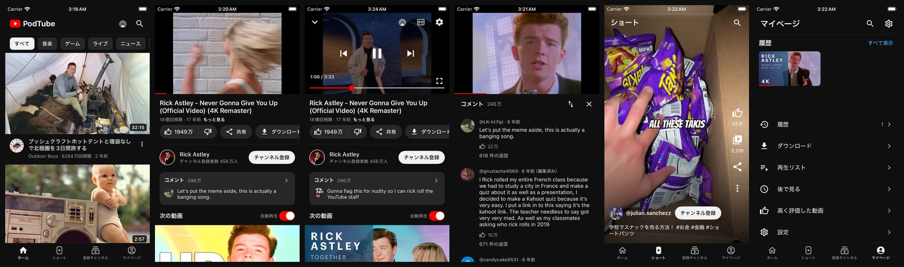

# PodTube — iOS 12 / iPod touch 向け YouTube クライアント

iOS 12 の iPod touch（第6世代 / 第7世代）で動く、非公式の YouTube クライアントです。
iPhone（ノッチあり・なし、iPhone 16e を含む）と iPad（iPad mini 2 など iOS 12 以降の 64bit 機）でも動きます。
iPad では、動画の一覧をカードのグリッド（縦向き 2 列・横向き 3 列）で表示し、横向きの再生ページは左に再生と詳細・右に関連動画の 2 ペインにします（YouTube の iPad 版を参考にした画面です）。
Android 版 YouTube の UI と機能にできるだけ寄せて、UIKit だけで作っています
（SwiftUI・async/await・SF Symbols は iOS 13 以降なので使っていません）。



（GitHub Actions のシミュレータで自動撮影した画面。ホーム / 再生 / 操作パネル / コメント / ショート / マイページ）

> 非公式アプリです。YouTube / Google とは無関係です。内部 API を使うため、YouTube 側の変更で突然動かなくなることがあります。

## 主な機能

| | |
|---|---|
| ホーム | おすすめフィード（各動画にチャンネルのアイコン。ログイン中のフィードはアイコンを含まないので、動画からチャンネルを調べて表示し、端末に覚えます）、トピックのチップ（音楽 / ゲーム / ライブ …）、続きの自動読み込み、ホームタブをもう一度押すと一番上へ。引っ張って更新すると、画面に表示した動画は後ろに回して別の動画を先頭に出します（未ログインのときは訪問者 ID も取り直します） |
| 検索 | 検索候補、検索履歴、動画・チャンネル・再生リスト、フィルタ（並べ替え / 期間 / 種類 / 長さ）。YouTube の URL（youtu.be、watch、shorts、playlist、チャンネル、@ハンドル）を貼り付けるとそのまま開きます。`podtube://` スキームにも対応（Safari のブックマークレットなどから） |
| 再生ページ | 画質自動切替（HLS、最大1080p）、画質上限・再生速度・字幕・チャプター・**音声トラックの選択**（音声が複数ある動画）・ループ・スリープタイマー・**統計情報**（解像度・コーデック・ビットレート・バッファなどを映像の上に表示）、ダブルタップで ±10 秒、シークバー（**押さえたまま横にスライドすると映像が場面に追従し、押さえたまま上へスライドすると、プレビュー画像のフィルムストリップで再生位置を細かく合わせられます**）、全画面（横向き）、ミニプレーヤー（下スワイプ）、**ピクチャ・イン・ピクチャ**（OS が対応する端末のみ）、バックグラウンド再生、ロック画面操作、AirPlay |
| 動画情報 | 高評価数、概要（URL・ハッシュタグ・タイムスタンプがタップ可）、チャンネル行、コメント（並べ替え・続き読み込み）、関連動画、自動再生スイッチ、再生リストの連続再生 |
| ダウンロード | 動画を画質を選んで端末に保存し、オフラインで再生（バックグラウンドでも転送を継続） |
| ショート | 縦スワイプのフィード、ループ再生 |
| チャンネル | バナー、登録者数、ホーム / 動画 / 再生リスト / 概要のタブ、共有 |
| ログイン | **Google アカウントでログイン**（YouTube の TV アプリと同じ「機器コード」方式）。ログインすると、ホームが**あなたのおすすめ**になり、登録チャンネルの新着・視聴履歴・後で見る・高く評価した動画・再生リストが**アカウントのもの**になります。高評価 / 低評価 / チャンネル登録 / 「後で見る」「再生リスト」への追加は YouTube に反映され、**このアプリで再生した動画も、アカウントの視聴履歴に記録されます**。ログインしなくても、今までどおり使えます（詳しくは下の「Google アカウントでのログイン」） |
| 登録チャンネル | ログイン中: アカウントの新着フィードと、最近動きのあるチャンネルの一覧。未ログイン: 端末内で管理し、各チャンネルの最新動画をまとめて表示（Google Takeout の CSV、NewPipe / Piped の JSON、OPML から取り込み可能） |
| マイページ | ログイン中: アカウントの履歴（このアプリで再生した動画は YouTube の履歴にも記録されます。反映される前や、記録できなかった分は、端末内の記録から先頭に補います）・再生リスト・後で見る・高く評価した動画。未ログイン: 端末内の視聴履歴（再開位置つき）・再生リスト・後で見る・高評価。ダウンロードはどちらでも端末内 |
| 設定 | ダーク / ライト、アプリの言語、コンテンツの地域、最大画質、既定の再生速度、履歴の一時停止、接続診断 など |

Safari の YouTube ページから PodTube で開くには、次をブックマークの URL に登録しておきます。

```
javascript:location.href='podtube://'+encodeURIComponent(location.href)
```

できないこと:

- **ピクチャ・イン・ピクチャ（PiP）は、OS が許す端末でしか使えません。** PiP は OS 標準の仕組み（`AVPictureInPictureController`）を使っていて、OS が対応していない端末では、ボタンを出しません。OS が許すのは、iPad が iOS 9 以降（機種によります）、iPhone / iPod touch が **iOS 14 以降**です。**iOS 12 の iPhone / iPod touch は OS が PiP を許さないので、脱獄しないかぎりボタンは出ません**（アプリが OS の許可を変えることはできません）。脱獄した端末では、OS 側の PiP を有効にする tweak を入れると使えます。r/jailbreak の iOS 12 向けの記事が使っている **ForceInPicture** は、SpringBoard・backboardd と、UIKit を使う全アプリ（PodTube を含む）で、OS の PiP の可否（MobileGestalt の問い合わせ）に「可」と答えさせる作りです。**作者の手元の iPod touch 第 6 世代（iOS 12.5.7、脱獄）で、ForceInPicture を入れて v0.5.5 にしたところ PiP が動いた**との報告を受けています（この 1 台だけの報告で、他の機種・iOS・脱獄の方法では確かめていません）。ただし、この端末では ForceInPicture が PodTube に読み込まれていても、MobileGestalt の問い合わせを書き換える部分が PodTube に当たりませんでした（接続診断で、その関数の先頭が書き換わっていないことを確認）。そこで **v0.5.3 以降の PodTube は、ForceInPicture が読み込まれていて OS が PiP を許さないときに限り、AVKit の判定と、AVKit が内部で使う Pegasus のプロキシ（SpringBoard と通信する部分）の判定を、自分で「可」に差し替えます**（それ以外の端末では何もしません）。その記事のコメントには、BigBoss の古い版は unc0ver の「tweak を有効にした脱獄」を妨げ、Spica のリポジトリの 1.1 は動いた（iPhone 7・iOS 12.1.1・unc0ver）という報告があります。入れたあとは、接続診断の「Picture in Picture」の行（先頭の時刻の次）に、OS が PiP を許しているか（the OS offers it / does not offer it）が出ます。ForceInPicture が読み込まれている端末では、その下に、PodTube の差し替えが当たったか（`PodTube's own override of AVKit's PiP check`）、MobileGestalt の値、PiP の部品の状態の行も出ます。記事にある YouPiP・YouTube Tools などは YouTube アプリ用なので、PodTube には要りません。ホームに戻ったときに自動で PiP にする機能（iOS 14.2 以降）は使っていません。音声だけのバックグラウンド再生は、PiP とは別に、これまでどおり使えます。
- **ログインしていても**、コメントの投稿・返信、新しい再生リストの作成、再生リストからの削除、アカウントの履歴の個別削除（このアプリで再生して端末内の記録から補った行だけは削除できます）、通知、メンバーシップは使えません（YouTube の TV 向け API にない、または未実装）。
- **登録チャンネルの全件の取得**: TV 向け API が返すのは「最近動きのあるチャンネル」だけで、ログイン直後に端末へ写せるのは多くても 20 件ほどです。それ以外のチャンネルは、動画やチャンネルのページを開いたときに登録済みかを確認して表示します。
- コメントへの返信の表示 / ライブチャット / 低評価数の表示: 未対応です。
- ショートの縦スワイプの画面（ショートタブ、ホームのショートの棚から開く画面）で見た動画は、アカウントの履歴にも端末内の履歴にも記録しません。
- シークバーの細かい位置合わせ（上へスライドするとプレビュー画像が出る操作）は、YouTube がプレビュー画像（ストーリーボード）を用意している動画だけで使えます。ライブ配信と、ダウンロードして再生する動画には無いので、横にスライドして場面に追従するところまでです。YouTube 公式アプリが出す「最も再生された部分」のグラフは付けていません。
- iPad の画面は YouTube の iPad 版に似せていますが、同じではありません（タブは 4 つのまま、ミニプレーヤーは画面下のバー、横向きの再生ページの右の列の上に PodTube の「次の動画」と自動再生スイッチの行が付く、など）。マイページ・設定など、カードのグリッドにしていない画面は、全幅に伸びた一覧です。マルチタスク（Split View など）には対応せず、常に全画面で動きます。
- ログインしていないとき、「高評価」「低評価」「登録」は端末内にだけ保存され、YouTube には送られません。
- ログイン中のホーム / 登録チャンネルのチャンネルアイコン: YouTube のフィードにはアイコンもチャンネル ID も含まれないため、チャンネル名で照合します（登録チャンネルとその一覧、視聴履歴、アイコン付きの動画から覚え、足りない分は動画の情報から調べて端末に保存します）。同じ名前の別チャンネルがあると、アイコンが入れ替わることがあります。

## 動作確認の状況

作者の環境は Windows（ARM）だけで、**実機の iOS 12 端末ではまだ試せていません**。確認できているのは次の範囲です。

| 確認した | 方法 |
|---|---|
| ビルド（Xcode 16.4、iOS 12.0 ターゲット、arm64）と IPA の構造（最小 OS 12.0、iOS 13 以降専用のライブラリを使っていない） | GitHub Actions |
| 画面の表示と操作（ホーム、検索、再生、コメント、チャンネル、ショート、マイページ、設定 など約 30 画面） | GitHub Actions の iOS 18 シミュレータ。スクリーンショットは各実行の `screenshots` アーティファクト |
| iPhone 16e と iPad（縦・横）の画面（ホーム、再生、コメント、全画面、検索、チャンネル、ショート、マイページ、設定、シート、ログイン画面 など） | GitHub Actions の iOS 18 シミュレータ（iPhone 16e、iPad mini）。各実行の `screenshots-iphone16e` / `screenshots-ipad` アーティファクト |
| ホーム / 登録チャンネルの各動画のチャンネルアイコン（ログイン中の形式の疑似フィードで、アイコンを動画から調べて表示。iPhone SE・iPhone 16e・iPad、ライト / ダーク、320pt 幅） | GitHub Actions のシミュレータ。アイコンの取得自体は実際の YouTube に問い合わせています（`ptcli owner <動画ID>` でも確認） |
| ホームの更新で先頭の動画が入れ替わること（未ログインのフィードを実際の YouTube で 5 回続けて更新: 上位 10 件に表示済みの動画は 0 本、前回の上位 10 件との共通は 0〜1 本。続きのページを読み足す処理も確認） | `Tools/ptcli home-fresh` |
| 履歴画面のチャンネルアイコン（アカウント版 / 端末内版、iPhone SE・iPhone 16e、320pt 幅） | GitHub Actions のシミュレータ（`-pt-demo-account` の疑似データ） |
| ログイン中の履歴の先頭に、このアプリで再生した動画が補われる表示（疑似アカウントの履歴に、端末内で再生した 1 本を足して確認。アカウント側と同じ動画は重複して出ない） | GitHub Actions のシミュレータ（iPhone 16e の `88_history_merged`） |
| ホームタブをもう一度押すと一番上へ戻る動作（スクロールしてからタブを押し直す） | GitHub Actions のシミュレータ（iPhone 16e の `89_home_scrolled` と `90_home_retap`。別々の起動なので、同じ画面の前後ではありません） |
| このアプリの再生を、YouTube のアカウントの視聴履歴に記録できること（Samsung TV 相当の `/player` 応答の統計 URL へ「再生した」と通知すると、約 10 秒で履歴の先頭に載る。視聴時間の通知も HTTP 204 で受理される）。以前の方式（匿名の `/player` 応答の統計 URL、`www.youtube.com` 宛て、yt-dlp 方式の 2 回送信）では、実アカウントで 3 本とも載らなかった | 実アカウントで、テスト動画 2 本（各数回）。Python での調査と、アプリと同じ Core のコード（`ptcli` の `a-played` / `a-session`。通知の準備より先に再生が終わる場合も含む）の両方で、履歴の 1 件目に載ることを確認。載った行は確認のたびに履歴から削除し、最後に履歴を 150 件までさかのぼって残っていないことを確認、トークンも失効させました。履歴はアカウントの履歴を TV 向け API で読み出して確認したもので、YouTube アプリや Web の画面で見たわけではありません |
| YouTube API の解析（ホーム / 検索 / 関連動画 / コメント / チャンネル / 再生リスト / ショート / HLS / 字幕）と、別々の動画 14 本での再生 URL の解決 | `Tools/ptcli`（実際の YouTube に対して実行） |
| 音声トラックの一覧の取得（`adaptiveFormats` の `audioTrack`）と、元の音声トラックの判別。音声トラックが 21 本の動画・9 本の動画・1 本だけの動画で確認 | `Tools/ptcli play <動画ID>`（実際の YouTube に対して実行） |
| 統計情報の表示（再生中の動画の上に、動画 ID・取得方法、解像度とフレームレート、コーデック、ビットレート、バッファ、コマ落ち、受信量、音量などが出る。iPhone SE 相当の縦画面） | GitHub Actions のシミュレータ（実際の YouTube の動画の再生中。`35_stats`） |
| ピクチャ・イン・ピクチャ（PiP）: 再生ページの上のバー（AirPlay の左）にボタンが出ること、押すと PiP の窓が開いて再生ページがミニ表示に退くこと、アプリを離れて設定アプリを開いても窓の映像が続くこと（4 秒あけた 2 枚で、映像が次の場面に進んでいる）。OS が PiP を許さない端末では、ボタンが出ず画面が崩れないこと、接続診断に「OS が PiP を許しているか」の行が出ること | GitHub Actions のシミュレータ。iPad mini（iOS 18）: `92_pip_button` `91_pip_active` `59_pip_background_a` / `_b`。iPhone SE（iOS 18）は OS が PiP を許さない状態で、`38_pip_button` `39_pip_button_320` `24_diag` |
| 音声トラックの選択（設定の「音声トラック」、選んだ音声への切り替え、次の動画への引き継ぎ）と、統計情報の表示 | 作者の手元の端末で v0.3.0 を使い、「完璧に動作しています」との報告を受けました（端末の機種と iOS のバージョンは記録していません）。CI のシミュレータでは、音声が複数ある動画を再生できず（9 本試して全て YouTube に再生を制限された）、音声トラックの一覧の画面は確認できていません |
| ログインの通信と解析: 機器コードの発行・承認待ちの応答・トークンの更新、アカウント情報、おすすめ、登録チャンネル、履歴、後で見る、高く評価した動画、再生リスト、チャンネルの登録状態、動画の高評価状態、続きの読み込み | `Tools/ptcli`。テスト用に承認してもらったアカウントで、**読み取りだけ**を実行（実アカウントの応答はリポジトリに入れていません） |
| 「何も変えない」書き込み: 高評価していない動画の高評価取り消し、登録していないチャンネルの登録解除、リストに無い動画の削除（形式の確認） | 同上。YouTube が受理することを確認（`edit_playlist` は `STATUS_SUCCEEDED`） |
| ログイン関連の画面（ログイン画面、ログイン後のホーム / 登録チャンネル / マイページ / 後で見る / 再生リスト / 保存シート / 設定） | シミュレータ。`-pt-demo-account` の**疑似データ**で表示（実アカウントではありません） |
| シークバーのスクラブ表示: 押さえている間の時刻のピル、操作パネルが隠れること、つまみが大きくなること、上へスライドしたときに出るフィルムストリップ（動画の実際の場面のプレビュー画像が並び、中央に白い線、上に時刻のピル）。iPhone SE・320pt 幅・iPad（縦と全画面の横） | GitHub Actions のシミュレータ。**状態は、タッチの代わりのテスト用の操作（`w:scrub` / `w:fine`）で作ったもので、指でスライドしたものではありません**。iPhone SE の `95_scrub` `96_fine` `97_fine_320`、iPad の `93_scrub` `94_fine` `95_fine_landscape`。プレビュー画像は実際の YouTube の動画のもの |
| プレビュー画像（ストーリーボード）の取得: 動画の応答の `storyboards` から、3 段階の大きさのシートの仕様を読み取り、1 コマずつ切り出す（確認した動画では、最大が 160×90 の 5×5 コマのシート） | `Tools/ptcli play <動画ID>`（実際の YouTube に対して実行）と、上のスクリーンショット |
| iPad の画面（iPad mini、iOS 18）: ホームと検索結果のカードのグリッド（縦 2 列・横 3 列）、ショートの棚（カード 166pt 幅）、中央寄せのタブバー、再生ページ（縦は全幅の詳細と 2 列の関連動画、横は左に再生と詳細・右に関連動画の 2 ペイン）、コメントが右の列に開くこと、ミニプレーヤー、概要欄の展開、操作パネル、ライトとダーク | GitHub Actions のシミュレータ（iPad mini A17 Pro、縦 744pt・横 1133pt）。縦: `70_home` `71_watch` `73_comments` `76_search` `89_home_scrolled`。横: `100_ipad_home_landscape` `101_ipad_watch_landscape` `102_ipad_watch_landscape_light` `103_ipad_comments_landscape` `104_ipad_mini_landscape` `105_ipad_expand_landscape` `106_ipad_controls_landscape`。横向きの画像は、シミュレータが 90° 回した状態で保存するので、見るときは戻します |
| iPhone の画面が iPad 対応で変わっていないこと（ホームの単列、再生ページの文字・区切り線・カードの位置が、iPad 対応前のスクリーンショットと同じ） | iPhone SE のシミュレータ（`01_home_dark` `05_watch` `96_fine`）。目で突き合わせたもので、画素単位の比較ではありません |

| まだ確認していない | 備考 |
|---|---|
| 実機でのスクラブの操作（押さえたまま横にスライドしたときの映像の追従の速さ、指をバーから離して上へスライドしたときのフィルムストリップへの切り替わり、指を離したときに合う位置） | CI のシミュレータにはタッチ操作が無く、スクリーンショットはテスト用の操作で作った状態です。追従は、シーク中に新しいシークを重ねず、最後の指の位置だけを追いかける作りです。実機での引っかかりや遅さは確かめていません |
| 実機の iPad（iPad mini 2 など）での起動・回転・全画面と、カードのグリッド・横向きの 2 ペイン | シミュレータは iOS 18 の iPad mini（A17 Pro。縦 744pt・横 1133pt）だけです。他の iPad の幅（768pt の縦、1024pt の横など）での見え方と、iOS 12 の iPad は未確認です |
| 実機の iOS 12 での起動と再生 | 設定 → **接続診断** で、端末上で何が通るかを確認できます |
| アプリの画面からのログインの通し（コードを承認 → アプリが受け取る → 画面が切り替わる） | 通信部分は `ptcli` で確認済みですが、アプリ上での通しは未確認です |
| ログイン中のホームを更新したときの入れ替わり | 実アカウントのフィードの形（1 ページ 15 件、続きは 6 ページ以上、再取得で約 6 割が同じ）は実測しましたが、更新の動作そのものは疑似データでしか見ていません |
| 高評価 / 低評価 / チャンネル登録・解除 / 「後で見る」「再生リスト」への追加・削除の、アカウントへの実際の反映 | アカウントを書き換えてしまうため、実行していません（上の「何も変えない」呼び出しだけ確認） |
| 実アカウントのフィードでのチャンネルアイコン | 疑似データ（実際の形式を真似たもの）でしか確認していません。実アカウントでの確認用トークンは作業後に失効させたため、再確認には新しい承認が要ります |
| アプリの画面で動画を再生したときに、実際に YouTube の履歴へ載ること | 通知を送る部分は `ptcli` で確認済みですが、アプリの再生処理（`PlayerManager`）につないだ状態は、CI でのビルドと、疑似アカウント（通知は送らない）での再生しか見ていません。確認用のトークンは作業後に失効させたため、再確認には新しい承認が要ります |
| 視聴時間の通知が、履歴の行の視聴率や「続きから再生」に効くこと | 通知は受理（HTTP 204）されますが、履歴の行の視聴率は変わりませんでした（10 % のまま）。効果があるかは未確認です |
| 音声が複数ある動画で、端末の言語に合う吹き替えが無いときに「自動」が選ぶ音声 | 音声の選び方は、これまでどおり AVFoundation の自動選択に任せています。YouTube のマニフェストの音声は、どれも既定の指定が無い（`DEFAULT=NO`）ため、どの音声が選ばれるかは確認していません |
| 統計情報の数値が、YouTube 公式の「詳細統計情報」と合うこと | 数値は AVFoundation のアクセスログ、読み込み済みの範囲、映像の形式などから作っています。公式の表示と突き合わせてはいません |
| 実機での PiP（iPad、iOS 14 以降の iPhone / iPod touch）。PiP の窓の「アプリに戻る」で再生ページへ戻る動作、窓を閉じたあとの再生の状態、窓の再生 / 一時停止ボタンとアプリの表示の同期 | シミュレータでは窓を操作できません。確認したのは、ボタンから窓を出すところと、アプリを離れても映像が続くところまでです |
| 脱獄した iOS 12 の iPhone / iPod touch で、OS 側の PiP を有効にしたときの動作（iPod touch 第 6 世代 / iOS 12.5.7 以外） | 作者の手元の iPod touch 第 6 世代（iOS 12.5.7、ForceInPicture）では、v0.5.5 で PiP が動いたとの報告を受けています。分かっているのは「PiP が動いた」ことまでで、窓の「アプリに戻る」などの細部は聞いていません。他の機種・iOS・脱獄の方法は確かめていません |
| バックグラウンドでのダウンロード / 音声再生、ロック画面の操作、AirPlay、横向き全画面の実機での挙動 | シミュレータでは確認できない部分です |

## IPA の入手とインストール

GitHub Actions が **署名なし IPA** を作ります。

- 最新ビルド: リポジトリの **Actions** タブ → 最新の実行 → Artifacts の `PodTube-ipa`
- タグ `v*` を付けると **Releases** に `PodTube-unsigned.ipa` が公開されます

署名なしなので、インストール時に自分で署名します。

- **Sideloadly / AltStore**（Apple ID で署名）: IPA をドラッグして iPod touch に入れます。無料の Apple ID だと 7 日で失効します。
- **脱獄済みの端末**（checkra1n / unc0ver など）: AppSync Unified を入れた上で、Filza や `ipainstaller` で IPA をインストールします。

### 7 日で失効する問題（脱獄していない端末）

無料の Apple ID で署名したアプリが 7 日で動かなくなるのは Apple の仕様で、**この制限そのものを外す方法は、調べた範囲では、脱獄を除けばありません**。現実的な対処は次のとおりです（2026 年 11 月に各ツールの公式ページで確認した内容です。実機の iOS 12 では試していません）。

- **期限の前に自動で署名し直す**: Sideloadly には、期限が近いアプリを自動で署名し直す常駐機能があります（公式サイトの対応は iOS 7 以降）。PC 側で Sideloadly の常駐機能が動いていて、端末が USB か同じネットワークの Wi-Fi で見つかると更新されます（Wi-Fi 経由にするには、先に USB でつないで設定しておく必要があり、見つけてもらうには端末の画面が点いている必要があります。PC を点けっぱなしにする必要があるかは、公式ページに書かれていません）。AltStore の最新版（2.3）は iOS 17.4 以降が必要なので、iOS 12 の端末には使えません（古い版は確認していません）。
- **有料の Apple Developer Program**（年 99 ドル）に入ると、署名したアプリが最長 1 年持ちます。
- 無料の Apple ID には、ほかに「同時に入れられるアプリは 3 本まで」「App ID を新しく作れるのは 7 日で 10 個まで」という制限もあります。

対応 OS は iOS 12.0 以降です（Swift ランタイムを同梱しているので 12.0 / 12.1 でも動きます）。

## Google アカウントでのログイン

YouTube の TV アプリと同じ **OAuth「機器コード」方式**です。Google のパスワードをこのアプリに入力することはありません。

1. マイページの **Google アカウントでログイン**（または 設定 → アカウント）を開くと、コード（例 `ABC-DEF-GHIJ`）が表示されます。
2. この端末の Safari か、別の端末（QR コードあり）で <https://www.google.com/device> を開き、コードを入力して、Google アカウントでログインして許可します。
3. アプリに戻ると、自動でログイン済みになります。

仕組みと注意:

- Google が OAuth トークンを受け付ける InnerTube クライアントは **TVHTML5（YouTube on TV）だけ**です（VISIONOS / iOS / ウェブ版にトークンを付けると HTTP 400）。そのため、アカウントに関わるもの（おすすめ・登録チャンネル・履歴・ライブラリ・高評価・登録・保存）は TV クライアントで取得・送信し、検索・再生・コメント・チャンネル表示はこれまでどおりログイン不要の VISIONOS クライアントで行います。YouTube Data API v3 は、このクライアント ID のプロジェクトでは無効なので使えません。TV の応答は `tileRenderer` という別の形式なので、専用のパーサーを持っています。
- トークンは端末の **キーチェーン**（`AfterFirstUnlock`）に保存します。キーチェーンの権限が無い署名方法でインストールした場合は、アプリ内のファイル（ファイル保護つき）に保存します。トークンも実アカウントの応答も、このリポジトリや CI には入っていません。
- **ログアウト**でトークンを端末から削除し、Google 側でも失効させます。Google アカウントの「サードパーティのアクセス」からも取り消せます。
- クライアント ID / シークレットは YouTube の TV アプリが使っている公開の値です（YouTube.js や SmartTube と同じ）。Google の対策で、ある日使えなくなる可能性があります。
- 高評価・登録・「後で見る」は、画面を速く保つために端末内の一覧にも写します。アカウント側で失敗したときは元に戻して知らせます。他の端末での変更は、動画を開いたとき・一覧を開き直したときに反映されます。
- **このアプリで再生した動画は、YouTube のアカウントの視聴履歴にも記録します**（ログイン中で、設定の「履歴を保存しない」がオフのとき）。動画が再生できる状態になると、**Samsung（Tizen）の TV を名乗る TVHTML5 クライアント**でトークン付きの `/player` を呼び直し（再生用とは別の、約 190 KB の追加の通信が、再生した動画ごとに 1 回かかります）、その応答に入っている**アカウントに結び付いた統計 URL**（`uga` パラメータがあります）へ「再生した」と通知します。実アカウントで確かめました: 通知の約 10 秒後に、履歴の先頭に載ります。再生を終えたとき・別の動画に移ったとき・停止したときには、視聴時間も通知します（ライブ配信と 5 秒未満の再生は除く。HTTP 204 で受理されますが、履歴の行の視聴率は変わりませんでした）。
- 記録の方式は試行錯誤の末です。匿名の `/player` 応答の統計 URL にトークンを付けて送っても HTTP 204 で受理されるだけで、履歴には載りません（`www.youtube.com` 宛てでも、yt-dlp 方式の 2 回送信でも同じ）。一般的な TV クライアント（Cobalt）の `/player` は、ログインしていても UNPLAYABLE（「ページを再読み込みする必要があります」）になり、試した身元のうち応じたのは Samsung のものだけでした。さらに `signatureTimestamp`（YouTube のページの `"STS"`。現在は 20760）が必要です。数か月前までの値は受け付けますが、拒否されたときは YouTube のページから読み直して端末に覚えます（6 時間に 1 回まで）。
- YouTube がこの身元を受け付けなくなると、記録は止まります（YouTube に 3 回続けて断られたら、10 分間は送るのをやめます。通信できないときの失敗は数えないので、ダウンロードした動画をオフラインで再生しても止まりません。再生には影響しません）。直し方は `config/clients.json` の `tv_samsung`（`clientVersion` / `userAgent` / `osVersion` / `signatureTimestamp`）の書き換えです。記録できていない間も、履歴画面とマイページの履歴の棚には、このアプリで再生した動画を端末内の記録から先頭に補って表示します（30 日以内・最大 40 件。YouTube 側の履歴と同じ動画は重複して出ません）。設定の「履歴を保存しない」をオンにすると、端末内の記録も YouTube への通知も止まります。

## 再生の仕組み（2026 年 11 月時点）

YouTube は 2025 年以降、ほとんどのクライアントで **PO トークン** や **SABR** を要求するようになりました。
このアプリは次の方法で、PO トークンも JavaScript プレーヤーも使わずに再生しています。

1. InnerTube API を **VISIONOS クライアント**（Apple Vision Pro 用）として呼びます。ログアウト状態でもホームフィード、検索、関連動画、チャンネル、コメントが取れ、`/player` が **HLS マニフェスト**（H.264 + AAC、最大 1080p、WebVTT 字幕つき）を返します。
2. リクエストには必ず **`visitorData`** を付けます。付けないと「ログインして bot ではないことを確認してください」が返ることがあります。取得は `visitor_id` エンドポイント（約 500 バイト）で、起動後の最初のリクエスト前に行います。
3. HLS は AVPlayer がそのまま再生します（画質は `preferredMaximumResolution` で制限）。HLS が無い動画は iOS クライアントの HLS → H.264 映像 + AAC 音声を `AVMutableComposition` で結合、の順にフォールバックします。
4. 字幕は `timedtext`（json3）を取得して、自前のオーバーレイで表示します（HLS 以外の再生でも使えます）。
5. 音声が複数ある動画（吹き替え・音声解説）は、`/player` の `adaptiveFormats` の各音声に `audioTrack`（`id` は `ja.3` のような言語と版、`displayName`、`audioIsDefault`）が付き、HLS マニフェストにも音声ごとの `EXT-X-MEDIA` が（音声の形式ごとの 2 グループに同じ内容で）並びます。AVPlayer はこれを選択肢（`AVMediaSelectionGroup`）として扱うので、アプリはそれを設定の「音声トラック」に一覧します（同じ音声が 2 回出ないよう、言語と名前でまとめます）。「自動」は端末の言語に任せる従来どおりの動き、選んだ言語は覚えて次の動画にも使います。HLS が使えない動画のフォールバックと、ダウンロードは、元の音声トラック（`audioIsDefault`）だけを使います（以前は、音声の言語を問わず最もビットレートが高いものを選んでいました）。

壊れたとき（YouTube 側の仕様変更）にまず見る場所:

1. 設定 → **接続診断** で、どの段階（訪問者 ID / ホーム / プレーヤー / HLS の解析）が失敗しているかが分かります。ログイン中は最後の行（`account history tracking`）で、履歴への記録に使う URL が取れているかも分かります（取れるかどうかを尋ねるだけで、履歴には何も送りません）。
2. クライアントのバージョンだけなら、アプリを作り直さずに **`config/clients.json`**（このリポジトリの main ブランチ）を書き換えるだけで直せます。アプリは起動時にこのファイルを読みます。ログイン中の履歴への記録は `tv_samsung` の項目（`signatureTimestamp` も）で直せます。
3. それ以外は `PodTube/Sources/Core/InnerTube.swift` の `Clients` と、`Tools/ptcli`（下記）の実行結果を見ます。

## 開発

```
project.yml                  XcodeGen の定義（.xcodeproj は CI で生成）
PodTube/Sources/Core         Foundation だけに依存する層（InnerTube クライアント、パーサー、モデル）
PodTube/Sources/App          UIKit の画面
Tools/ptcli                  Core を実機の YouTube に当てる CLI（Linux / macOS）。`PT_TOKEN_FILE` を渡すと `a-home` `a-subs` などのアカウント系の読み取りも試せます（`a-track <動画ID>` は履歴に載せる統計 URL が取れるかの確認で、読み取りだけ。`a-played` / `a-session` は**アカウントの履歴に書き込みます**）
Tools/ci_screenshots.sh      CI のシミュレータで画面を巡回してスクリーンショットを撮る
.github/workflows/build.yml  IPA のビルド + スクリーンショット
```

- Core は Linux でもビルドできます（`Tools/linux_build.sh home` など）。API の変化を手元ですぐ確認できます。
- 起動引数 `-pt-demo-account` で、アカウント系の応答を疑似データに差し替えたデモ用アカウントになります（CI がログイン後の画面を撮るためのものです。実際のログインには使いません）。
- CI では「署名なし IPA のビルド」と「シミュレータで 20 画面ほどのスクリーンショット」を毎回実行します（`screenshots` アーティファクト）。
- アイコンは `Tools/make_icons.py`、Material アイコンの取得は `Tools/fetch_icons.py` で生成します（Material Icons は Apache License 2.0）。

## ライセンス

MIT License（`LICENSE`）。Material Icons は Apache License 2.0 です。
